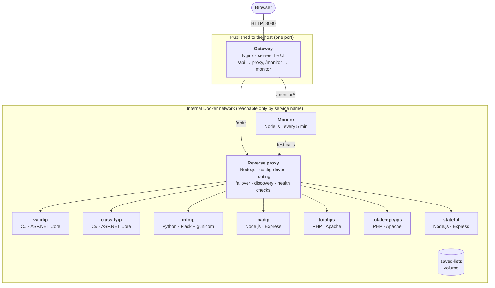
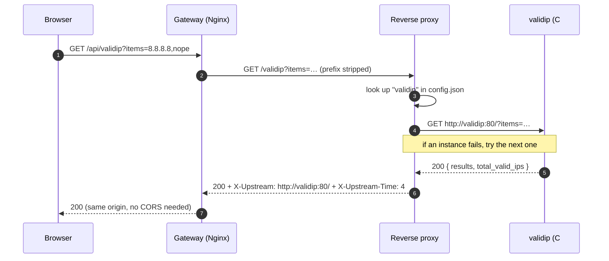

# IP Checker: microservices in four languages

Paste a list of IP addresses and six independent services answer six questions about it: how many
entries, how many are blank, which are valid, IPv4 or IPv6, what kind of address each is, and which
should never appear as a public source. Each service is its own container, written in the language
that suited it, behind a gateway and a reverse proxy.

The UI draws the architecture live: every request is shown travelling through the gateway and proxy to
the service that answers it, with that service's real response time.

[](https://github.com/mattchris3/ipchecker-microservices/actions/workflows/ci.yml)


## Run it

You need Docker. One command builds and starts all ten containers:

```bash
git clone https://github.com/mattchris3/ipchecker-microservices.git
cd ipchecker-microservices
docker compose up --build
```

Open <http://localhost:8080>, pick a sample list and press **Run all checks**. If port 8080 is taken,
run `PORT=9000 docker compose up --build` instead. Stop everything with `docker compose down`.

## Architecture



### How one check travels



The UI sends the six checks in parallel and merges the answers into one row per address.

## What each service does

| Question | Service | Language | Container port | Notes |
|---|---|---|---|---|
| How many entries? | `totalips` | PHP 8.3 | 80 | Blank entries count; empty input is 0 |
| How many are blank? | `totalemptyips` | PHP 8.3 | 80 | Whitespace-only counts as blank |
| Which are valid? | `validip` | C# / .NET 9 | 80 | IPv4: four parts, 0–255, no leading zeros. IPv6: .NET's parser |
| IPv4 or IPv6? | `classifyip` | C# / .NET 9 | 80 | Same rules as `validip` |
| What kind of address? | `infoip` | Python 3.12 | 5001 | Private, loopback, link-local, CGNAT, documentation, multicast or public; owners of well-known resolvers |
| Should it be a public source? | `badip` | Node.js 22 | 3000 | Bogon filter: flags the IANA special-purpose ranges, with the RFC for each |
| Save and load a list | `stateful` | Node.js 22 | 3000 | UUID per list, stored on a named volume |
| Route, fail over, discover | `revproxy` | Node.js 22 | 3000 | See below |
| Check everything regularly | `monitor` | Node.js 22 | 4000 | Calls each service through the proxy every 5 minutes |
| Serve the UI, single entry point | `frontend` | React + Nginx | 80 | The only container with a published port |

Every analysis service has the same contract: `GET /?items=<comma-separated list>` returns JSON with
`error`, the original `items`, and its answer. That shared contract is what lets the proxy route to
any of them generically, and lets a service be rewritten in another language without touching the
others.

## Design decisions

- **One way in.** Only the gateway publishes a port. Every other container is reachable only on the
  internal Docker network by its service name, which mirrors how a cluster exposes one ingress and
  keeps services private. Because the UI and API share an origin, the browser needs no CORS.
- **Config-driven routing.** `ipchecker-revproxy/config.json` maps each service name to one or more
  upstream URLs. The proxy re-reads it when it changes, so routes can be added or repointed without a
  restart. Give a service a second URL and the proxy fails over to it, with no code change.
- **Failover.** For each request the proxy tries the configured instances in order and returns the
  first answer. If all fail it returns `503` listing each failure, so callers see why.
- **Service discovery and health.** `GET /api/discover/services` lists what the proxy can route to;
  `GET /api/health/<service>` probes every instance and reports latency. The UI uses both for the
  green and red dots on the diagram.
- **Observability.** Every proxied response carries `X-Upstream` (which instance answered) and
  `X-Upstream-Time` (how long it took). The request log and the diagram read these headers.
- **Polyglot on purpose.** Each service uses a different stack (ASP.NET Core, Express, Flask,
  Apache/PHP) to show that a stable HTTP contract, not a shared codebase, is what holds a
  microservice system together.
- **Stateless and stateful.** Six services keep no state and could be scaled out freely. `stateful`
  is the exception: it writes to a named Docker volume, so saved lists survive restarts and redeploys.
- **Monitoring as its own service.** The monitor is a separate container that exercises the real
  path (through the proxy) on a schedule, rather than code inside the services checking themselves.
- **Hardened images.** Node and Python services run as non-root users, installs are reproducible
  (`npm ci`, pinned major versions), test files never ship in the PHP web root, and Python runs under
  gunicorn rather than Flask's development server.

## Tests

Each service is tested in its own language, and CI runs them all, then builds the whole system with
Docker Compose and sends real requests through the gateway.

| Service | Run from its folder | Framework |
|---|---|---|
| `validip`, `classifyip` | `dotnet test tests` | xUnit |
| `infoip` | `pip install -r requirements-dev.txt && pytest tests` | pytest |
| `badip`, `revproxy`, `stateful`, `monitor` | `npm ci && npm test` | Jest + Supertest |
| `totalips`, `totalemptyips` | `php src/tests/tests.php` | plain PHP |
| `frontend` | `npm ci && npm test` | Vitest |

The reverse proxy's tests start small fake services on random ports and check routing, failover past
a dead instance, `503` when every instance is down, discovery, health checks and config reloading.

## Kubernetes

Each service folder has the manifests it was deployed with on Queen's University Belfast's teaching
cluster: a **Deployment** (the container and its image), a **Service** of type `ClusterIP` (a stable
internal name, the equivalent of the Compose service name) and an **Ingress** (a public hostname). The
images and namespace in them point at the university's registry and cluster, so they document the
deployment rather than run anywhere else as they are.

| Docker Compose | Kubernetes |
|---|---|
| `services.<name>` + `build` | `Deployment` with an image from a registry |
| Service name on the internal network | `Service` (`ClusterIP`) |
| `ports:` on the gateway | `Ingress` |
| Named volume | `PersistentVolumeClaim` |

## Developing the UI

```bash
docker compose up --build -d     # the services
cd ipchecker-frontend
npm install
npm run dev                      # http://localhost:5173, forwarding /api to the gateway on :8080
```

## Project structure

```
docker-compose.yml          the whole system
ipchecker-frontend/         React + TypeScript UI, Nginx gateway config
ipchecker-revproxy/         reverse proxy (Node.js) and config.json
ipchecker-validip/          C# service + xUnit tests
ipchecker-classifyip/       C# service + xUnit tests
ipchecker-infoip/           Python service + pytest tests
ipchecker-badip/            Node.js service + Jest tests
ipchecker-totalips/         PHP service + tests
ipchecker-totalemptyips/    PHP service + tests
ipchecker-stateful/         Node.js service, stores lists on a volume
ipchecker-monitor/          Node.js scheduled checker
.github/workflows/ci.yml    tests per language, then a full Docker Compose run
```

## What I'd add next

- Two replicas of one service in `config.json`, with a button in the UI that stops one, to show
  failover happening live.
- Distributed tracing with OpenTelemetry instead of response headers.
- A Helm chart so the Kubernetes manifests run on any cluster.
- Country lookups from a licensed GeoIP database (the current info service deliberately doesn't guess).

## Author

**Matthew Christensen**, Computer Science, Queen's University Belfast.
